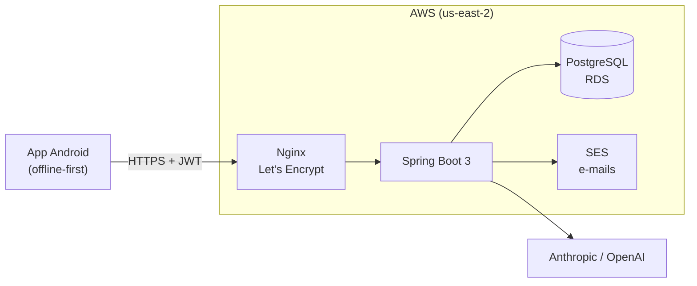

# 🌱 SafraPay — Backend

API REST do SafraPay, app de gestão financeira rural (TCC de Ciência da Computação na UNESC, 2026). Atende o [app Android](https://github.com/GustavoPessi/safrapay-android) e está em produção na AWS.

## Stack

- **Java 17** e **Spring Boot 3.3** (Web, Data JPA, Validation, Security, Actuator)
- **PostgreSQL** no Amazon RDS, com migrations **Flyway** e Hibernate em modo `validate`
- **Autenticação:** JWT com refresh token rotativo e senhas com BCrypt
- **Infraestrutura:** EC2 com Nginx e HTTPS (Let's Encrypt), domínio no Route 53, e-mails transacionais pelo Amazon SES, serviço gerenciado por systemd
- **IA:** API da Anthropic (Claude) para interpretar lançamentos e API da OpenAI para transcrever áudio

## Arquitetura



## Principais funcionalidades

| Área | O que faz |
| --- | --- |
| Autenticação | Cadastro com confirmação de e-mail, login, refresh token com rotação e detecção de reaproveitamento, redefinição de senha por link |
| CRUD | Propriedades, talhões, safras, receitas, despesas, metas, máquinas e anotações |
| Sincronização | Endpoints `GET` e `POST /api/{entidade}/sync` para as 8 entidades, mais o feed de exclusões |
| Multiusuário | Equipes com convites por e-mail e papéis (dono, gerente e colaborador), tarefas de manutenção com prazo e responsável |
| Assistente de IA | `POST /api/chat/mensagem`: texto, fotos de nota fiscal, planilhas (.xlsx, .csv, .txt) e áudio viram lançamentos propostos ou consultas |

## Decisões técnicas

**Sincronização por UUID e last-write-wins.** O app e o servidor nunca compartilham ids autoincremento. Cada registro é identificado pelo UUID gerado no celular. O push faz upsert por UUID e só sobrescreve quando o `atualizado_em` do cliente é mais novo. O pull devolve o que mudou depois do marcador do cliente. Filhos referenciam o pai pelo UUID (`propriedadeUuid`, `talhaoUuid`, `safraUuid`).

**Exclusões sincronizadas (soft delete).** Excluir marca `excluido_em` no item e em cascata nos filhos, igual ao Room do app. Um aparelho atrasado não consegue "ressuscitar" um item excluído. Excluir uma máquina não apaga despesas: só desfaz o vínculo.

**Posse dos dados em toda requisição.** Cada service valida a cadeia de posse (despesa → safra → talhão → propriedade → conta). Registro de outro usuário responde 404, nunca 403, para não revelar que existe.

**Proteção da fazenda.** Em equipes, o gerente grava na conta do dono. Cada sincronização envia o cabeçalho `X-SafraPay-Fazenda`, e um filtro recusa com 409 se a equipe mudou, impedindo que um gerente removido enquanto estava offline envie dados para a conta errada.

**IA com validação no servidor.** A IA responde por *tool use* em JSON. O servidor revalida tudo: UUIDs inventados são descartados, categorias e datas são conferidas e há limite diário de mensagens por usuário.

**Schema versionado.** Toda mudança de banco é uma migration Flyway nova (`V1` a `V6` hoje), nunca editada depois de aplicada.

## Como rodar localmente

Defina as variáveis de ambiente (nunca commite valores reais):

```
DB_URL=jdbc:postgresql://<host>:5432/<banco>
DB_USERNAME=<usuario>
DB_PASSWORD=<senha>
JWT_SECRET=<segredo>
```

Opcionais: `ANTHROPIC_API_KEY` e `OPENAI_API_KEY` (assistente de IA), `AWS_*` e `SES_REMETENTE` (e-mails).

```
mvn spring-boot:run
```

O Flyway cria o schema na primeira execução. Health check: `GET /actuator/health`.

## Estrutura

Um pacote por domínio, cada um com controller, service e DTOs:

```
com.safrapay.backend
  auth, usuario, equipe, colaborador     → contas, papéis e equipes
  propriedade, talhao, safra, receita,
  despesa, metafinanceira, maquina,
  anotacaomaquina, categoriadespesa      → domínio e sincronização
  exclusao                               → exclusões sincronizadas
  chat                                   → assistente de IA
  security, config, email, util          → infraestrutura
```

## Convenções de código

- Nomes do domínio em português (`Safra`, `valorAlvo`, `sincronizarPush`). Em inglês só os termos técnicos e de framework (`Controller`, `Service`, `Request`, token, hash, uuid).
- Nomes que vão para o JSON ou para o banco não se renomeiam por padronização, porque são contrato com o app e com o schema.
- Atributos sempre `private` e objetos de valor imutáveis como `record`.

## Autor

**Gustavo Borges Pessi** · [LinkedIn](https://www.linkedin.com/in/gustavo-pessi-b8a09b368/) · [GitHub](https://github.com/GustavoPessi)
