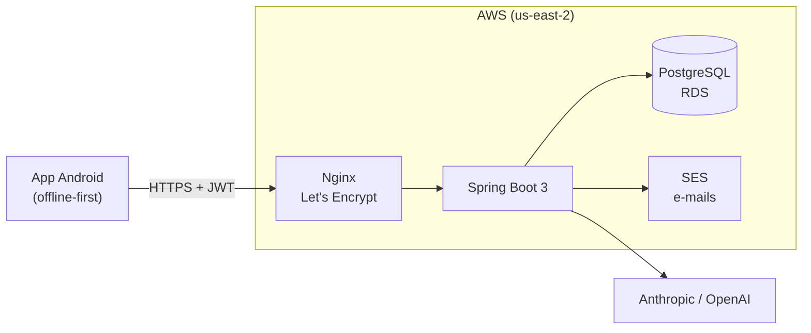

# SafraPay: Backend

Servidor (API REST) do SafraPay, aplicativo de gestão financeira e contábil para pequenos e médios produtores rurais. Trabalho de Conclusão de Curso em Ciência da Computação, UNESC, 2026. Autor: Gustavo Borges Pessi.

Este arquivo explica como avaliar e como executar o servidor (seções 1 e 6).

O aplicativo Android fica no repositório [safrapay-android](https://github.com/GustavoPessi/safrapay-android), que tem as suas próprias instruções (instalação do APK e roteiro de teste do aplicativo).

## 1. Para avaliar não é preciso rodar o servidor

O backend já está em produção na AWS, no endereço **https://api.safra-pay.com**, e é esse servidor que o APK usa. Para testar o sistema basta instalar o APK e **criar a própria conta pelo aplicativo** (passo a passo no README do [safrapay-android](https://github.com/GustavoPessi/safrapay-android)). Não há conta de demonstração: o próprio cadastro já testa o servidor. Os e-mails de confirmação do cadastro e de "Esqueci minha senha" são enviados pelo servidor a partir de `noreply@safra-pay.com` (confira também a caixa de spam).

Verificações rápidas pelo navegador:

| Endereço | O que deve aparecer |
| --- | --- |
| https://api.safra-pay.com/actuator/health | `{"status":"UP"}` (servidor e banco de dados no ar) |
| https://api.safra-pay.com/api/propriedades | erro 403: as rotas da API exigem login (token JWT) |

As seções 6 e 7 explicam como executar o servidor no próprio computador, caso o avaliador queira conferir o código rodando.

## 2. Tecnologias

| Item | Versão / serviço |
| --- | --- |
| Linguagem | Java 17 |
| Framework | Spring Boot 3.3.5 (Web, Data JPA, Validation, Security, Actuator) |
| Banco de dados | PostgreSQL (produção: Amazon RDS, PostgreSQL 18.3) |
| Migrations | Flyway (`V1` a `V6`, em `src/main/resources/db/migration`) |
| Autenticação | JWT com refresh token rotativo; senhas com BCrypt |
| E-mails | Amazon SES (confirmação de cadastro, redefinição de senha, convites de equipe) |
| Assistente de IA | API da Anthropic (Claude Haiku) e API da OpenAI (transcrição de áudio) |
| Produção | EC2 (Amazon Linux), Nginx com HTTPS (Let's Encrypt), serviço systemd, domínio no Route 53 |

## 3. Arquitetura



## 4. O que a API oferece

| Área | Rotas principais |
| --- | --- |
| Contas | `/api/auth` (registrar, login, refresh, logout, confirmar e-mail, esqueci/redefinir/alterar senha), `/api/usuario/perfil` |
| Cadastros | `/api/propriedades`, `/api/talhoes`, `/api/safras`, `/api/receitas`, `/api/despesas`, `/api/metas-financeiras`, `/api/maquinas`, `/api/anotacoes-maquina`, `/api/categorias-despesa` |
| Sincronização | `GET` e `POST /api/{entidade}/sync` nas 8 entidades e `/api/exclusoes/sync` (exclusões) |
| Uso em equipe | `/api/equipe` (convites, papéis de gerente e colaborador), `/api/colaborador` (máquinas e tarefas do colaborador) |
| Assistente de IA | `POST /api/chat/mensagem` (texto, fotos, planilhas e áudio) |
| Administração | `GET /api/admin/usuarios` e a página `/admin.html` (só para os e-mails de `ADMIN_EMAILS`) |
| Páginas web | `/confirmar-email.html`, `/redefinir-senha.html` (abertas pelos links dos e-mails) |

## 5. Decisões técnicas

**Sincronização por UUID e last-write-wins.** O app e o servidor nunca compartilham ids autoincremento. Cada registro é identificado pelo UUID gerado no celular. O push faz upsert por UUID e só sobrescreve quando o `atualizado_em` do cliente é mais novo. O pull devolve o que mudou depois do marcador do cliente. Filhos referenciam o pai pelo UUID (`propriedadeUuid`, `talhaoUuid`, `safraUuid`).

**Exclusões sincronizadas (soft delete).** Excluir marca `excluido_em` no item e em cascata nos filhos, igual ao Room do app. Um aparelho atrasado não consegue "ressuscitar" um item excluído. Excluir uma máquina não apaga despesas: só desfaz o vínculo.

**Posse dos dados em toda requisição.** Cada service valida a cadeia de posse (despesa → safra → talhão → propriedade → conta). Registro de outro usuário responde 404, nunca 403, para não revelar que existe.

**Proteção da fazenda.** Em equipes, o gerente grava na conta do dono. Cada sincronização envia o cabeçalho `X-SafraPay-Fazenda`, e um filtro recusa com 409 se a equipe mudou, impedindo que um gerente removido enquanto estava offline envie dados para a conta errada.

**IA com validação no servidor.** A IA responde por *tool use* em JSON. O servidor revalida tudo: UUIDs inventados são descartados, categorias e datas são conferidas e há limite diário de mensagens por usuário.

**Schema versionado.** Toda mudança de banco é uma migration Flyway nova (`V1` a `V6` hoje), nunca editada depois de aplicada.

## 6. Como executar localmente

### 6.1 Pré-requisitos

- **JDK 17** (por exemplo, Amazon Corretto 17 ou Eclipse Temurin 17).
- **Maven 3.9** ou superior (ou abrir o projeto no IntelliJ IDEA, que já traz o Maven).
- **PostgreSQL 14** ou superior instalado e rodando.

### 6.2 Criar o banco de dados

Basta um banco vazio. As tabelas são criadas pelo Flyway na primeira execução.

```sql
CREATE DATABASE safrapay;
```

### 6.3 Variáveis de ambiente

Os valores reais de produção ficam só no servidor (arquivo `.env` fora do Git) e **não fazem parte deste repositório**. Para rodar localmente, defina pelo menos as obrigatórias:

| Variável | Obrigatória | Para que serve |
| --- | --- | --- |
| `DB_URL` | sim | Endereço JDBC do banco, por exemplo `jdbc:postgresql://localhost:5432/safrapay` |
| `DB_USERNAME` | sim | Usuário do PostgreSQL |
| `DB_PASSWORD` | sim | Senha do PostgreSQL |
| `JWT_SECRET` | sim | Segredo para assinar os tokens. Use um texto aleatório longo (64 caracteres ou mais) |
| `SES_REMETENTE` | sim | E-mail remetente. Localmente pode ser qualquer endereço, por exemplo `teste@exemplo.com` |
| `APP_BASE_URL` | não | Endereço usado nos links dos e-mails (padrão: `https://api.safra-pay.com`) |
| `AWS_SES_REGION` | não | Região do Amazon SES (padrão: `us-east-2`) |
| `AWS_ACCESS_KEY_ID`, `AWS_SECRET_ACCESS_KEY` | não | Credenciais da AWS para enviar e-mails. Sem elas os e-mails não são enviados (ver 6.5) |
| `ANTHROPIC_API_KEY` | não | Chave da API da Anthropic. Sem ela o assistente de IA responde "não configurado" |
| `OPENAI_API_KEY` | não | Chave da OpenAI para transcrever áudio. Sem ela, só o áudio fica indisponível |
| `IA_MODELO`, `IA_MAX_TOKENS`, `IA_MAX_TOKENS_ARQUIVO`, `IA_LIMITE_DIARIO` | não | Ajustes do assistente (padrões: `claude-haiku-4-5-20251001`, 1024, 8192 e 50 mensagens por dia) |
| `IA_TRANSCRICAO_API_KEY`, `IA_TRANSCRICAO_MODELO`, `IA_TRANSCRICAO_URL` | não | Troca do provedor de transcrição (padrão: OpenAI `gpt-4o-mini-transcribe`) |
| `JWT_EXPIRATION_MS`, `JWT_REFRESH_DIAS` | não | Validade do token de acesso (padrão: 24 h) e do refresh token (padrão: 90 dias) |
| `ADMIN_EMAILS` | não | E-mails com acesso à página de administração, separados por vírgula |

Exemplo no **PowerShell** (Windows):

```powershell
$env:DB_URL = "jdbc:postgresql://localhost:5432/safrapay"
$env:DB_USERNAME = "postgres"
$env:DB_PASSWORD = "sua-senha-do-postgres"
$env:JWT_SECRET = "troque-por-um-texto-aleatorio-com-pelo-menos-64-caracteres-0123456789"
$env:SES_REMETENTE = "teste@exemplo.com"
```

Exemplo no **bash** (Linux ou macOS):

```bash
export DB_URL=jdbc:postgresql://localhost:5432/safrapay
export DB_USERNAME=postgres
export DB_PASSWORD=sua-senha-do-postgres
export JWT_SECRET=troque-por-um-texto-aleatorio-com-pelo-menos-64-caracteres-0123456789
export SES_REMETENTE=teste@exemplo.com
```

### 6.4 Iniciar o servidor

No mesmo terminal em que as variáveis foram definidas, na pasta do projeto:

```
mvn spring-boot:run
```

Ou gerar o pacote e executá-lo:

```
mvn clean package -DskipTests
java -jar target/backend-0.0.1-SNAPSHOT.jar
```

O servidor sobe na porta **8080**. Na primeira execução o Flyway aplica as migrations `V1` a `V6`. Para conferir, abra http://localhost:8080/actuator/health, que deve responder `{"status":"UP"}`.

No IntelliJ IDEA: abrir a pasta do projeto, escolher o JDK 17 e rodar a classe `BackendApplication`, com as variáveis da tabela em *Run > Edit Configurations > Environment variables*.

### 6.5 Criar uma conta de teste localmente

Sem credenciais da AWS, o servidor não envia o e-mail de confirmação (o erro só fica registrado no log), e o login só é liberado para contas com e-mail confirmado. Para testar localmente:

1. Criar a conta:
   ```
   curl -X POST http://localhost:8080/api/auth/registrar -H "Content-Type: application/json" -d "{\"nome\":\"Avaliador\",\"email\":\"avaliador@teste.com\",\"senha\":\"Senha123!\"}"
   ```
2. Confirmar o e-mail direto no banco:
   ```sql
   UPDATE usuario SET email_verificado = true WHERE email = 'avaliador@teste.com';
   ```
3. Fazer login e copiar o `token` da resposta:
   ```
   curl -X POST http://localhost:8080/api/auth/login -H "Content-Type: application/json" -d "{\"email\":\"avaliador@teste.com\",\"senha\":\"Senha123!\"}"
   ```
4. Usar o token nas demais rotas, por exemplo:
   ```
   curl http://localhost:8080/api/propriedades -H "Authorization: Bearer COLE_O_TOKEN_AQUI"
   ```

### 6.6 Usar o aplicativo com o servidor local

O aplicativo vem configurado para o servidor de produção (`BASE_URL` em `RetrofitClient.java`, no repositório do app). Para apontá-lo para um servidor local seria preciso trocar esse endereço e compilar o app de novo. Para a avaliação, o recomendado é usar o APK com o servidor de produção (seção 1).

## 7. Teste automatizado do uso em equipe

O script `scripts/teste-multiusuario.sh` (bash, precisa de `curl` e `python3`) testa convites, papéis, tarefas e permissões contra um servidor em execução e desfaz tudo no final. Ele pede três contas já confirmadas (dono, gerente e colaborador):

```
bash scripts/teste-multiusuario.sh                            # servidor local (porta 8080)
bash scripts/teste-multiusuario.sh https://api.safra-pay.com  # servidor de produção
```

## 8. Segurança

- Nenhuma senha, chave de API ou credencial está no repositório nem no histórico do Git. Os valores de produção ficam apenas no arquivo `.env` do servidor.
- As senhas dos usuários são guardadas apenas como hash BCrypt. Nem o administrador do sistema consegue vê-las.
- A posse dos dados é conferida em toda requisição (ver seção 5).

## 9. Estrutura do código

```
src/main/java/com/safrapay/backend
  auth, usuario, equipe, colaborador   contas, papéis e equipes
  propriedade, talhao, safra, receita,
  despesa, metafinanceira, maquina,
  anotacaomaquina, categoriadespesa    domínio e sincronização
  exclusao                             exclusões sincronizadas
  chat                                 assistente de IA
  admin                                página de administração
  security, config, email, util        infraestrutura
src/main/resources
  application.properties               configuração (lê as variáveis de ambiente)
  db/migration                         migrations Flyway V1 a V6
  static                               páginas web (confirmar e-mail, redefinir senha, admin)
scripts/teste-multiusuario.sh          teste do uso em equipe
```

## 10. Convenções de código

- Nomes do domínio em português (`Safra`, `valorAlvo`, `sincronizarPush`). Em inglês só os termos técnicos e de framework (`Controller`, `Service`, `Request`, token, hash, uuid).
- Nomes que vão para o JSON ou para o banco não se renomeiam por padronização, porque são contrato com o app e com o schema.
- Atributos sempre `private` e objetos de valor imutáveis como `record`.

## 11. Autor

**Gustavo Borges Pessi** · [LinkedIn](https://www.linkedin.com/in/gustavo-pessi-b8a09b368/) · [GitHub](https://github.com/GustavoPessi)
